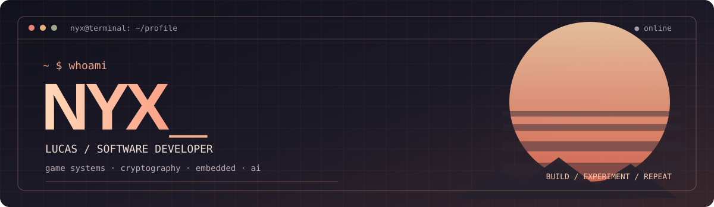

<div align="center">



<br />

**`developer @ A30x1`** &nbsp;·&nbsp; **`based in Brazil`** &nbsp;·&nbsp; **`22 years old`**

[](https://whoslucaxs.github.io/me/)
[](https://whoslucaxs.github.io/me/about.html)
[](https://github.com/whoslucaxs)

*"If I can imagine it, I'll probably try to build it."*

</div>

---

### `01 / about.exe`


Hey! I'm **Lucas**, a **22-year-old Brazilian software developer** who loves turning ideas into real projects, especially when they involve creativity, technology, and a bit of experimentation.

I'm currently working as a **Developer at A30x1**, developing add-ons and gameplay experiences for the **Minecraft Bedrock Marketplace**.

Beyond game development, I enjoy **cryptography, embedded systems, artificial intelligence, automation, and self-hosting**. Sometimes that means experimenting with an encrypted password manager; other times, it's an ESP32 controller or a local AI assistant.

My main stack includes **TypeScript, JavaScript, and Node.js**, and I'm always exploring new tools when the project calls for them.

<br clear="right" />

### `02 / tech-stack.json`

<div align="center">

**Languages & runtime**


**Tools & playground**


</div>

### `03 / current-interests.md`

<table>
<tr><td width="50%" valign="top">

**🎮 Game development**

Minecraft Bedrock add-ons, gameplay systems, custom content, and world generation.

</td><td width="50%" valign="top">

**🔐 Software & cryptography**

Encrypted applications, password management, and authentication experiments.

</td></tr>
<tr><td valign="top">

**🤖 AI & automation**

Local assistants, practical tools, and system integrations.

</td><td valign="top">

**⚡ Embedded & infrastructure**

ESP32, microcontrollers, Linux, and self-hosted services.

</td></tr>
</table>

### `04 / workbench/`

```text
~/workbench
├── minecraft-bedrock/   # add-ons, mechanics, world generation
├── cryptography/        # encrypted vault and authentication
├── embedded/            # ESP32 and hardware prototypes
├── ai-lab/              # local assistants and automation
└── game-dev/            # small experiments and game jams
```

> This is a map of what I build and explore, not a list of public repositories.

### `05 / more-info`

<details>
<summary><b>Expand terminal session</b></summary>
<br />

```bash
$ cat interests.txt
Game development
Cryptography & authentication
Local AI & automation
ESP32 & embedded systems
Linux & self-hosting

$ echo $CURRENT_STATUS
"Learning, building, experimenting."
```

</details>

---

<div align="center">

<sub>Made with curiosity, code, and probably too many open terminals.</sub>

<br />

<a href="https://whoslucaxs.github.io/me/about.html"><b>↳ read more about me</b></a>

</div>
